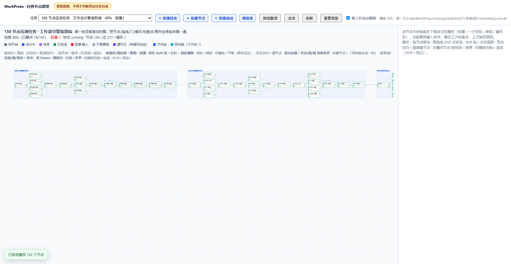
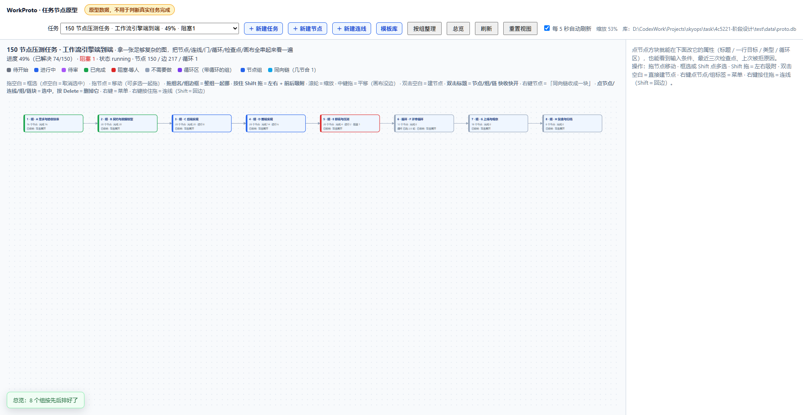

# WorkProto · SkyOps 阶段五「最小可行性验证」

> 版本：**0.4.0**（2026-10-28，拆分前基线）· 仓库：<https://github.com/Seal1nThePot/AI-work-proto-Test>

**版本梯度**（主号 0.4 不动：接口、页面、验收一条不变，只搬文件/加功能）：

| 版本 | 对应 | 说明 |
| --- | --- | --- |
| 0.4.0 | 基线 | 拆分前：ProtoStore 2117 行 / app.js 3237 行 / 40 端点 / 160+192 全绿 |
| 0.4.1 ~ 0.4.8 | P1 ~ P8 | 每个阶段一个 patch，**行为不变，只有文件搬家** |
| 0.4.9 | 拆分收口 | 结构完成（47 个运行时文件），四条不变式全过 |
| 0.4.10 | `xuqiu.txt` 三条需求 | 功能版本（整理视图可复原 / 紧凑堆叠视图 / 连线接节点组） |
| **0.5.0** | 全量 TypeScript | 26 个 `src\*.js` → `src\*.ts`，`tsc` 出 JS，脚本顺序模型与 `new Function` 注入不变；见拆分方案第十节 |


任务：`tsk_4c5221cf1e7a4a17a2302d3d4146d783` 阶段五（2026-10-28）
性质：**独立原型**——自带 SQLite、不连不写 SkyOps 库、不改 SkyOps 代码与页面。数据是原型数据，**不用于判断真实任务完成**。

## 一、一句话

把「任务节点 + 连线 + 门 + 循环 + 检查点」这套设计跑成可执行的闭环，用六条硬场景验收；页面上节点直接看得见**标题 + 一行目标 + 状态**，点开能读检查点原文和上次被拒原因，并且可以**在画布上直接建节点 / 画线 / 分组 / 声明循环 / 改属性**。

跑通标准：**160 项接口断言 + 192 项页面断言**，全绿。

## 二、怎么跑

```
启动点.bat                             # 一键：停旧进程 → 构建 → 起 5081 → 等健康 → 拉起浏览器新窗口
启动点.bat chrome                      # 指定浏览器（edge / firefox 同理；默认 Edge，没装则 Chrome，再没有用系统默认）
启动点.bat open                        # 服务已在跑，只把浏览器窗口拉起来
启动点.bat check                       # 四条一起跑：build + 160 + 192 + 16 守恒
启动点.bat stop                        # 停 5081
run-proto.cmd                          # 旧的极简启动：只 build + 起服务，不拉浏览器、不停旧进程
pwsh -File verify\seed-demo.ps1        # 灌三个 demo 任务（服务没起会自动起）
node verify\seed-complex.mjs           # 造一个 150 节点 / 233 连线的复杂任务（见第五节）
pwsh -File verify\run-acceptance.ps1   # 接口验收：自起 5082 + 临时库，跑完自清
pwsh -File verify\run-ui-smoke.ps1     # 页面验收：自起 5083 + 临时库，DOM 桩跑真页面脚本（按 index.html 顺序拼接）
pwsh -File verify\run-split-check.ps1  # 拆分守恒检查（16 条：文件数/函数数/符号数/索引新鲜度）
pwsh -File verify\run-perf.ps1         # 服务端往返延迟对照表（不参与验收）
node verify\run-canvas-bench.mjs       # 无头 Chrome 量一次渲染成本并截图（不参与验收）
stop-proto.cmd                         # 停 5081（等价 启动点.bat stop）
```

- 浏览器窗口由 `verify\wait-and-open.ps1` 拉起：它先轮询 `/api/health`（最多 40 秒），确认 200 才开窗，避免打开就是 `ERR_CONNECTION_REFUSED`
- 服务：`http://127.0.0.1:5081/`（REST 与页面同一进程）
- 库：`data\proto.db`（可删，删了重启即空库）
- 环境变量：`PROTO_PORT`、`PROTO_DB`、`PROTO_AGENT`、`PROTO_SYNC`

## 三、目录

```
test\
  README.md                    本文件：入口、怎么跑、边界
  启动点.bat                   一键入口：构建+起服务+拉浏览器窗口 / open / stop / check
  docs\                        四份分离文档（见第四节）
    architecture.md            架构：进程、代码地图、数据层与提交口径、前端渲染、性能
    api.md                     接口契约：端点、图增量规则、门与放行、拒因码、钉死的五处
    features.md                功能：画布手势、拖动与吸附、节点/连线/组/循环、链、预设
    acceptance.md              验收：160 + 192 项断言清单、性能证据、测不到的地方
  backend\WorkProto.Api\
    ProtoDb.cs                 库路径、连接与 PRAGMA、整份 DDL、老库补列与搬家
    Program.cs                 端点表
    Proto.*.cs                 业务，15 个 partial 文件：Infra / Gate / Propagate / Lease / Lifecycle /
                               Read / NodeWrite / Group / Edge / Template / Task / ApiResult / Reasons /
                               Contracts / Rows（逐文件职责见 backend\WorkProto.Api\索引.md）
    索引.md                     每个文件夹一份，由 tools/gen-index.mjs 从文件头生成，勿手改
    wwwroot\                   index.html（脚本装配单）+ style.css（无 app.js：逻辑全在 src\）
      src\                     已切出的分段脚本（顺序即依赖）：
                                00-const / 01-state / 02-dom / 03-api / 10-geo / 11-layout / 12-chain /
                                13-group / 20-render / 21-render-diff / 30-select /
                                40-panel-node … 45-cycle（右栏面板 6 个）/ 50-form-task 51-form-node 52-form-edge 60-write /
                                70-drag 71-pointer（手势）/ 80-menu 81-keyboard 90-bind 99-boot（装配）
  verify\
    run-acceptance.ps1         接口验收（160 项）
    run-ui-smoke.ps1           页面验收（192 项）+ ui-smoke.mjs（DOM 桩）
    run-perf.ps1               往返延迟对照（FULL vs NORMAL）
    run-canvas-bench.mjs       无头 Chrome 量渲染：DOM 计数 + render()/fitView() 耗时 + 截图
    wait-and-open.ps1          等 /api/health 200 再拉起浏览器新窗口（启动点.bat 调它）
    run-split-check.ps1        16 条拆分守恒检查
    seed-demo.ps1              样板链 / 回边循环 / 择一 100% 三个 demo 任务
    seed-complex.mjs           150 节点 / 233 连线的复杂任务（8 组 + 循环区 + 择一 + k_of_n + 人工门控）
  docs\screenshot-150-nodes.png  那张复杂图的样子（run-canvas-bench.mjs 拍的）
  data\proto.db                demo 库（可删）
  run-proto.cmd / stop-proto.cmd
```

## 四、文档地图

| 想知道什么 | 读哪份 |
| --- | --- |
| 这套东西怎么搭起来的、为什么这么快、库和提交怎么配 | [docs/architecture.md](docs/architecture.md) |
| 有哪些接口、什么情况会被拒、拒绝码叫什么、门怎么判 | [docs/api.md](docs/api.md) |
| 画布上手势怎么用、组/循环/链/预设是怎么回事 | [docs/features.md](docs/features.md) |
| 怎么证明它跑通了、哪些东西测不到 | [docs/acceptance.md](docs/acceptance.md) |

## 五、想看复杂图

```
node verify\seed-complex.mjs          # 造任务 tsk-150-demo（150 节点 / 233 连线 / 8 组 / 1 循环区）
node verify\run-canvas-bench.mjs      # 无头 Chrome 打开它，量渲染并截一张 docs\screenshot-150-nodes.png
```

这个任务故意把能塞的东西都塞进去了：8 个阶段组（A 需求 → H 归档）、`F 评审循环` 是带回边的循环区（上限 3、已跑 2 轮）、E 里一个 **择一**（3 条候选选 1 条、其余落 skipped）、一个 **k_of_n**（4 条里够 2 条）、两条**人工门控**（一条已点头、一条待点头）、`H` 组**收纳成牌**、两个节点**收纳成一行**，进度刷成 68 approved / 17 active / 4 review / 1 blocked(cycle-limit) / 2 skipped / 58 pending。结构刻意做成「1 进 3~4、3~4 合 1」的沙漏串，方便看布局效果。

**一句实话**：结构是走 REST 建的真数据，**进度状态是直接刷库刷出来的"画"**，不是真跑出来的——只为看画布在压力下的样子，别拿它的百分比当结论。

打开之后建议按这个顺序看：

1. 点工具栏 **「按组整理」** —— 组按依赖排先后，组内按依赖分层（三合一、一进三的沙漏形状）；
2. 点 **「总览」** —— 8 块编号牌排成格子，每块写着完成/进行/阻塞与循环轮次，组间只剩一条束线标 ×N；
3. **双击一块牌** —— 只摊开这一组并自动聚焦，其余还是牌。





## 六、边界（别当成已实现）

**没做的**：步骤表（A7）、选路失败替补与消歧、空产物完成依据、运行中改线与历史方案、多 agent 并行、审核规则集编辑、任务级 `final_review`/`submit`/`confirm`（原型只有节点级，任务级终审仍归 SkyOps）。

**只能走 REST 的**：认领、完成、检查点、择一、解除阻塞——页面没有按钮，验收脚本即此路径。

**一条刻意的边界**（2026-10-28 主人定）：**同向链只是看法，不落库**——`collapsedChains` 只放内存，刷新即摊开；为了让这条长住而加表/加接口是被明确否掉的（原话「只是前端显示整理——后端一直是那个代码」）。

**已知的坑**：节点/边 id 是跨任务全局的，测试数据要用新的 id 命名空间；`CreateTask` 贴图时节点/边缺 `id` 会写进 NULL 主键（SQLite 允许），随后 `GET graph` 500——建图一定要带 id。

## 七、与 SkyOps 的关系

SkyOps 仍是唯一权威。原型的结论只用于回答「这套模型跑不跑得通」；搬迁或替换等主人决定（取代决定点），在此之前不写迁移脚本、不动 SkyOps 的认领 SQL 与 6 个不变量测试。
